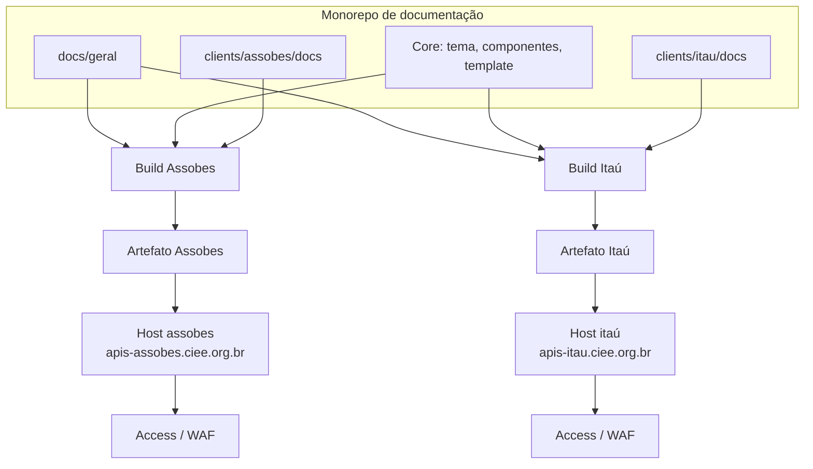
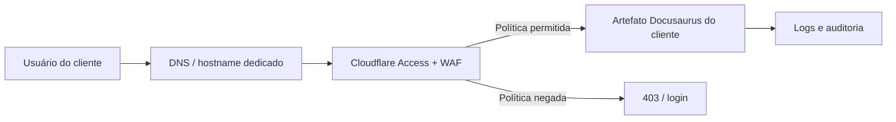
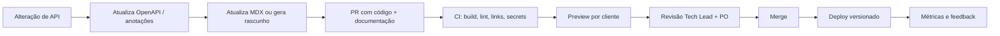
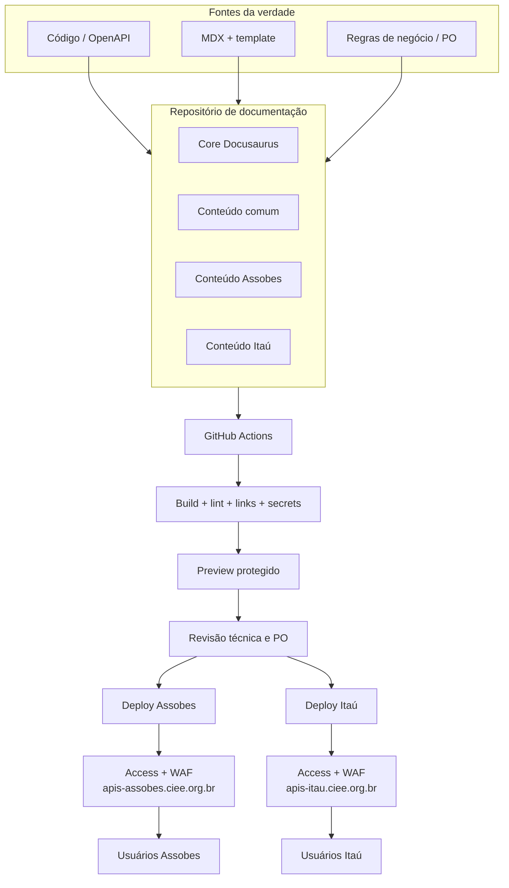

# Arquitetura e Evolução — Portal de APIs CIEE

> **Status:** proposta de arquitetura para validação da gestão e da PO.
> **Público:** liderança, Product Owner, arquitetura, segurança e times de integração.
> **Escopo:** evolução da POC atual para um portal de documentação de APIs
> multi-cliente, versionado, protegido e sustentável.
> **Última atualização:** 31/10/2026.

---

## 1. Recomendação executiva

A POC atual valida com sucesso a experiência de navegação, a identidade visual e
o fluxo de publicação. Para produção, a recomendação é evoluir em quatro frentes:

| Frente | Decisão proposta |
| --- | --- |
| **Multi-tenant** | Um deployment e um domínio por cliente, gerados pelo mesmo repositório e pipeline, com artefatos isolados. |
| **Versionamento** | Versionamento nativo do Docusaurus (`v1`, `v2` etc.), com política de depreciação e versões ativas por cliente. |
| **Segurança** | Proteção de borda por cliente com Cloudflare Access, complementada por IP allowlist quando o parceiro tiver egresso fixo. |
| **Governança** | Documentação como código: PR junto com o backend, checks obrigatórios no CI, preview por cliente e automação assistida por IA. |

**Mensagem principal:** não devemos usar uma única URL pública com menus
filtrados por cliente. Isolamento real exige artefatos, domínios e políticas de
acesso separados. O Docusaurus continua sendo o gerador; o que muda é a camada de
build, publicação e proteção.

---

## 2. Estado atual da POC

Hoje existe uma única aplicação Docusaurus publicada no GitHub Pages:

```text
poc-docs/
├── docs/
│   ├── geral/       # conteúdo comum
│   ├── assobes/     # rotas do Grupo Assobes
│   ├── itau/        # rotas do Itaú
│   └── clientes/    # página de entrada por cliente
├── src/             # tema, home e componentes
├── templates-docs/  # template e plano de automação
└── .github/
    └── workflows/
        └── deploy.yml
```

Essa estrutura é adequada para a POC porque:

- reduz o custo de validação visual;
- permite comparar rapidamente o conteúdo dos dois clientes;
- simplifica a demonstração para a gestão;
- mantém um único pipeline de build.

Ela **não é adequada para produção** porque:

- o mesmo artefato contém documentação de todos os clientes;
- a URL é compartilhada;
- não há autenticação nem autorização;
- qualquer pessoa com o link acessa o conteúdo;
- um erro de menu ou busca pode expor informação de outro parceiro.

---

## 3. Princípios de arquitetura

1. **Isolamento por padrão:** cada cliente recebe apenas o conteúdo que pode ver.
2. **Documentação como código:** o `.mdx` evolui no mesmo PR da API.
3. **Fonte da verdade única:** código/OpenAPI para o contrato; MDX para a
   narrativa e as regras de negócio.
4. **Privilégio mínimo:** credenciais, permissões e ambientes separados por
   cliente.
5. **Artefato imutável:** o que foi validado é o que será publicado.
6. **Revisão humana:** automação e IA geram rascunhos; pessoas aprovam regras de
   negócio e segurança.
7. **Compatibilidade:** contratos antigos permanecem disponíveis pelo tempo
   acordado com o cliente.

---

## 4. Estratégia de segregação de clientes (multi-tenant)

### 4.1 Por que a POC usa uma instância única

A POC tem como objetivo validar a experiência, não a segurança de produção. Uma
única instância permite mostrar rapidamente o padrão visual, a navegação, os
admonitions, os payloads e o deploy no GitHub Pages.

Esse modelo é aceitável **somente** para demonstração interna e conteúdo
fictício. Ele não deve ser promovido a produção sem a separação descrita abaixo.

### 4.2 Modelo alvo: um artefato por cliente

Em produção, o build deve gerar um artefato específico para cada cliente. O
artefato do Itaú não contém os arquivos do Assobes, e vice-versa.



Cada artefato é autocontido: contém o tema compartilhado, o conteúdo comum
(`geral`) e somente a pasta do cliente. O conteúdo comum pode ser duplicado no
build; isso é preferível a manter uma aplicação única com filtro em runtime.

### 4.3 Dimensões de isolamento

| Dimensão | Garantia em produção |
| --- | --- |
| **Conteúdo** | O artefato do cliente só contém `docs/geral` + `clients/<cliente>/docs`. |
| **URL** | Domínio ou hostname dedicado por cliente. |
| **Autenticação** | Política de acesso específica por hostname. |
| **Credenciais** | Secrets e tokens de deploy separados por ambiente. |
| **Cache** | Cache e CDN isolados por host. |
| **Analytics** | Propriedade e retenção separadas, sem dados cruzados. |
| **Busca** | Índice de busca separado, quando existir. |
| **Deploy** | Environment e permissões separados no GitHub Actions. |
| **Auditoria** | Logs de acesso por cliente e por política. |

### 4.4 Opções de hospedagem

| Opção | Isolamento | Autenticação | Esforço | Observação |
| --- | --- | --- | --- | --- |
| **GitHub Pages por repositório** | Alto, se cada cliente tiver seu próprio site/repo | Não nativa; exige proxy/edge | Baixo/médio | Simples e barato; um Pages por repositório. Para monorepo, é necessário publicar em repositórios separados. |
| **Cloudflare Pages + Access** | Alto, um projeto por cliente | SSO, OTP, IP allowlist, service tokens | Médio | Boa combinação para documentação estática com acesso corporativo. |
| **Azure Static Web Apps** | Alto, um ambiente por cliente | Integração com Entra ID | Médio | Indicado se o CIEE já for padronizado em Azure. |
| **AWS S3 + CloudFront + WAF** | Alto, uma distribuição por cliente | WAF, Cognito ou proxy | Médio/alto | Mais controle e mais operação. |
| **Vercel/Netlify com SSO** | Alto, um projeto por cliente | SSO/edge | Médio | Alternativa, sujeita à política de fornecedores. |

**Recomendação:** Cloudflare Pages + Cloudflare Access, ou Azure Static Web Apps
caso o CIEE tenha padronização Microsoft. GitHub Pages pode continuar como
hospedagem da POC, mas não é a melhor opção para autenticação de produção.

### 4.5 Pipeline com GitHub Actions

O GitHub Actions orquestra o build por cliente usando uma matriz. Cada cliente
tem seu próprio environment, com aprovação e credenciais isoladas.

Exemplo conceitual (a implementar):

```yaml
jobs:
  build:
    strategy:
      matrix:
        client: [assobes, itau]
    runs-on: ubuntu-latest
    steps:
      - uses: actions/checkout@v4
      - uses: actions/setup-node@v4
        with:
          node-version: 22
          cache: npm
      - run: npm ci
      - run: npm run build -- --client ${{ matrix.client }}
      - uses: actions/upload-artifact@v4
        with:
          name: docs-${{ matrix.client }}
          path: build

  deploy:
    needs: build
    strategy:
      matrix:
        client: [assobes, itau]
    environment: docs-${{ matrix.client }}
    runs-on: ubuntu-latest
    steps:
      - name: Publicar artefato do cliente
        run: ./scripts/deploy.sh ${{ matrix.client }}
```

Boas práticas:

- Usar **OIDC** entre GitHub Actions e o provedor de nuvem, evitando chaves
  estáticas de longa duração.
- Separar `environment` por cliente (`docs-assobes`, `docs-itau`) com regras de
  aprovação.
- Não compartilhar token de deploy entre clientes.
- Gerar o artefato uma vez e promovê-lo entre ambientes, sem rebuild.
- Proteger também os ambientes de preview de PR.

### 4.6 GitHub Pages no cenário multi-cliente

O GitHub Pages publica um site por repositório. Para manter isolamento estrito
com GitHub Pages, as opções são:

1. Um repositório por cliente, com seu próprio Pages e domínio.
2. Um monorepo que publica artefatos em repositórios separados via credenciais
   restritas.
3. Migrar a publicação para um provedor com múltiplos projetos e autenticação
   nativa.

A opção 3 é a mais indicada para produção. A opção 1 é aceitável para uma
primeira fase, mas adiciona custo de manutenção de múltiplos repositórios.

### 4.7 Decisão recomendada

- Um hostname por cliente:
  - `apis-assobes.ciee.org.br`
  - `apis-itau.ciee.org.br`
- Um artefato por cliente, sem conteúdo de outros parceiros.
- Um environment de deploy por cliente.
- Conteúdo comum versionado e incluído em cada artefato.
- Nenhum filtro de conteúdo em runtime como mecanismo de segurança.

---

## 5. Versionamento nativo de APIs

### 5.1 Como o Docusaurus versiona

O Docusaurus possui versionamento nativo pelo plugin de docs. O conteúdo atual
fica em `docs/`; as versões anteriores são copiadas para
`versioned_docs/version-<versão>/`, com controle em `versions.json`.

Fluxo básico:

```bash
# Congela o conteúdo atual como versão v1
npx docusaurus docs:version v1
```

Estrutura resultante:

```text
docs/                              # versão atual (ex.: v2)
versioned_docs/
└── version-v1/                    # conteúdo congelado da v1
versioned_sidebars/
└── version-v1-sidebars.json
versions.json                      # ["v1"]
```

O portal pode exibir um seletor de versão na navbar com
`type: 'docsVersionDropdown'`. O usuário alterna entre a versão atual e as
versões anteriores sem perder a navegação.

### 5.2 URLs `/v1/` e `/v2/`

Por padrão, a versão atual fica em `/docs/` e as versões anteriores em
`/docs/<versão>/`. O caminho pode ser customizado no `docusaurus.config.ts`:

```ts
docs: {
  lastVersion: 'current',
  versions: {
    current: {
      label: 'v2 (atual)',
      path: 'v2',
      badge: true,
    },
    v1: {
      label: 'v1 (legado)',
      path: 'v1',
      banner: 'unmaintained',
    },
  },
},
```

Resultado possível:

```text
https://apis-assobes.ciee.org.br/docs/v1/...
https://apis-assobes.ciee.org.br/docs/v2/...
```

A raiz `/docs/` deve redirecionar para a versão ativa do cliente. O redirecionamento
pode ser feito no host, no CDN ou por uma página inicial de versões.

### 5.3 Versões por cliente

Cada cliente pode ter um conjunto próprio de versões ativas:

| Cliente | Versão ativa | Versões legadas | Estratégia |
| --- | --- | --- | --- |
| Grupo Assobes | v1 | — | Cliente em fase inicial; uma versão ativa. |
| Itaú | v2 | v1 | Escopo estendido; v1 mantida durante a migração. |

No build por cliente, o `docusaurus.config.ts` pode usar
`onlyIncludeVersions` e `lastVersion` para restringir o que será publicado. Isso
evita que um cliente veja versões de contrato que não lhe pertencem.

Exemplo:

```ts
const client = process.env.DOCS_CLIENT ?? 'assobes';

const versionsByClient = {
  assobes: {
    lastVersion: 'current',
    onlyIncludeVersions: ['current'],
  },
  itau: {
    lastVersion: 'current',
    onlyIncludeVersions: ['current', 'v1'],
  },
};
```

### 5.4 Política de ciclo de vida

- **Versão ativa:** recebe correções e evoluções.
- **Versão legada:** congelada, com banner de “não mantenida” e data de sunset.
- **Versão descontinuada:** removida após o prazo contratual, com redirecionamento
  para a versão ativa.

Recomendações:

1. Versionar apenas mudanças de contrato relevantes, não cada deploy.
2. Usar versionamento semântico (`v1`, `v2`) para comunicação com o cliente.
3. Publicar changelog e guia de migração a cada nova versão.
4. Definir com a PO o prazo de convivência entre versões.
5. Manter a versão legada somente leitura, sem novos endpoints.
6. Nunca remover uma versão sem aviso e redirecionamento.

### 5.5 O que pertence à versão

| Item | Versionar? | Observação |
| --- | --- | --- |
| Contrato de endpoint e payload | Sim | Mudança incompatível exige nova versão. |
| Regras de negócio | Sim | A regra vale para a versão do contrato. |
| Exemplos e cURL | Sim | Precisam acompanhar a versão. |
| Textos institucionais | Não | Ficam no conteúdo comum. |
| Tema e componentes | Não | Compartilhados entre versões. |
| Política de acesso | Não | Aplicada por hostname, não por versão. |

---

## 6. Segurança e camada de acesso

### 6.1 Premissa

Um site Docusaurus é estático: depois do build, todo o conteúdo está no artefato
e é servido ao navegador. Portanto:

- autenticação feita apenas no JavaScript do cliente **não protege nada**;
- esconder o link ou o item de menu **não é segurança**;
- separar por pasta ou query string **não é isolamento**;
- a proteção precisa acontecer **antes** da entrega do conteúdo.

### 6.2 Opções de proteção de borda

| Opção | Como funciona | Vantagens | Limitações | Uso recomendado |
| --- | --- | --- | --- | --- |
| **Cloudflare Access** | Política por hostname, com IdP, OTP, grupos e IP | SSO, auditoria, policies por cliente, service tokens | Dependência de fornecedor; configuração de IdP | **Recomendado para produção** |
| **IP allowlist** | WAF/CDN libera apenas faixas de IP | Simples para parceiros com egresso fixo | Não cobre usuários remotos ou IP dinâmico | Camada adicional |
| **Basic Auth** | Usuário e senha no proxy/edge | Rápido de configurar | Credencial compartilhada, sem SSO, pouca auditoria | Apenas preview interno/temporário |
| **mTLS** | Certificado de cliente | Alta assurance para B2B | Gestão de certificados complexa | Parceiros de alto risco |
| **VPN / private link** | Acesso por rede privada | Forte isolamento | Baixa usabilidade para parceiros | Times internos e integrações críticas |

### 6.3 Modelo recomendado em camadas



1. **DNS e hostname dedicados** por cliente.
2. **Cloudflare Access** com aplicação por hostname e políticas por grupo de IdP.
3. **IP allowlist** adicional para parceiros com IP fixo.
4. **mTLS** para parceiros que exigem assurance extra.
5. **Headers de segurança** no edge: HSTS, CSP, `X-Content-Type-Options`,
   `Referrer-Policy` e `Permissions-Policy`.
6. **Bloqueio de indexação** (`X-Robots-Tag: noindex` e `robots.txt`) para
   conteúdo restrito.
7. **Logs de acesso** retidos conforme a política de segurança do CIEE.

### 6.4 Matriz de acesso proposta

| Cliente | Host | Política principal | Política adicional |
| --- | --- | --- | --- |
| Grupo Assobes | `apis-assobes.ciee.org.br` | Access + grupo `grp-assobes` | IP allowlist do parceiro, se houver egresso fixo |
| Itaú | `apis-itau.ciee.org.br` | Access + grupo `grp-itau` | mTLS ou IP allowlist, conforme acordo |
| Times internos | `apis-interno.ciee.org.br` | SSO CIEE | VPN / rede corporativa |
| Preview de PR | URL temporária | Access restrito ao time | Expiração automática |

### 6.5 O que não fazer

- Proteger conteúdo apenas com senha no frontend.
- Publicar todos os clientes no mesmo artefato e filtrar o menu.
- Usar a mesma credencial para todos os parceiros.
- Colocar tokens reais, CPF, dados bancários ou segredos nos exemplos MDX.
- Deixar previews de PR públicos.
- Confiar em URL “não divulgada”.
- Indexar documentação restrita em buscadores.
- Compartilhar o mesmo environment de deploy entre clientes.

---

## 7. Governança e pipeline de atualização (CI/CD)

### 7.1 Fluxo de documentação como código



### 7.2 Regra de ouro

> **Nenhuma alteração de contrato de API é considerada concluída sem a
> documentação correspondente no mesmo PR.**

Isso evita o cenário mais comum de obsolescência: o código muda, o texto fica
para depois.

### 7.3 Fluxo de Pull Request

1. O dev cria a branch e implementa a alteração de backend.
2. Atualiza o `.mdx` usando o template de
   [`templates-docs/template-endpoint.mdx`](templates-docs/template-endpoint.mdx)
   ou aciona o gerador.
3. Abre o PR com o checklist de documentação preenchido.
4. O CI executa os checks obrigatórios.
5. O preview do cliente é publicado com proteção de acesso.
6. Tech Lead revisa o contrato técnico; PO valida regras de negócio.
7. Após aprovação, o merge dispara o deploy da versão correspondente.

### 7.4 Checks obrigatórios no CI

| Etapa | Ferramenta sugerida | Bloqueante |
| --- | --- | --- |
| Instalação determinística | `npm ci` | Sim |
| Typecheck | `npm run typecheck` | Sim |
| Build do Docusaurus | `npm run build` | Sim |
| Links quebrados | `onBrokenLinks: 'throw'` | Sim |
| Lint de Markdown/MDX | `markdownlint-cli2` ou equivalente | Sim |
| Placeholders não substituídos | script próprio | Sim |
| Segredos nos exemplos | `gitleaks` ou equivalente | Sim |
| Preview por cliente | provedor de hospedagem | Sim |
| Aprovação de ambiente | GitHub Environments | Sim |

### 7.5 Definition of Done de uma API

- [ ] Código e testes implementados.
- [ ] OpenAPI/anotações atualizados.
- [ ] Página MDX criada ou atualizada.
- [ ] Payload de entrada e saída conferidos.
- [ ] Headers de autenticação documentados.
- [ ] Regras de negócio revisadas pela PO.
- [ ] Status HTTP previstos na tabela.
- [ ] Exemplos com dados fictícios.
- [ ] Build e links verdes.
- [ ] Preview validado no PR.

### 7.6 Automação por IA e código-fonte

A evolução está descrita em
[`templates-docs/README-AUTOMACAO.md`](templates-docs/README-AUTOMACAO.md).
Resumo:

1. A aplicação expõe OpenAPI ou controllers anotados.
2. Um extrator gera um modelo intermediário em JSON.
3. Um gerador preenche o template e cria o esqueleto do MDX.
4. A IA enriquece descrições, exemplos e explicações de regras.
5. O dev e a PO revisam o conteúdo.
6. O PR segue o mesmo pipeline de qualidade.

**Guardrails:**

- IA não faz merge automático.
- IA não inventa endpoint, campo ou status fora do schema.
- Exemplos precisam passar por validação de JSON e de dados fictícios.
- Regras de negócio exigem aprovação humana.
- Toda geração deve ser rastreável (fonte, versão do modelo, diff).

### 7.7 Detecção de obsolescência

Para evitar que a documentação “envelheça” sem ninguém perceber:

- Job agendado compara o OpenAPI atual com o último OpenAPI usado no build.
- Se houver divergência, abre uma issue com label `docs-drift`.
- O job também verifica endpoints sem página MDX correspondente.
- Um dashboard acompanha a cobertura documental por cliente e versão.
- Alertas de 404 e feedback do usuário indicam conteúdo ausente ou quebrado.

### 7.8 Métricas de acompanhamento

| Métrica | Objetivo |
| --- | --- |
| Cobertura de endpoints documentados | 100% dos endpoints publicados |
| Cobertura de exemplos de payload | 100% dos endpoints com request/response |
| Tempo entre mudança de API e docs | Próximo de zero (mesmo PR) |
| Build success rate | > 99% |
| Links quebrados | Zero |
| Prazo de resposta a `docs-drift` | Definido com a PO |
| Acessos negados indevidos | Próximo de zero |
| Feedback de parceiros | Acompanhado por release |

---

## 8. Arquitetura alvo consolidada



---

## 9. Roadmap de evolução

| Fase | Entrega | Resultado esperado |
| --- | --- | --- |
| **0 — POC atual** | Docusaurus único, conteúdo fictício, deploy GitHub Pages | Validação visual e de navegação |
| **1 — Isolamento** | Build por cliente, domínios separados, environments no Actions | Fim do conteúdo cruzado em produção |
| **2 — Acesso** | Cloudflare Access/Azure Entra ID, políticas por cliente, headers | Acesso restrito e auditável |
| **3 — Versionamento** | `v1`/`v2`, dropdown, banners, política de sunset | Contratos legados e novos convivendo |
| **4 — Governança** | PR obrigatório, checks, preview, drift detection | Documentação sempre atualizada |
| **5 — Automação** | OpenAPI/AST + gerador + IA assistida | Menos trabalho manual e mais consistência |

As fases 1 e 2 podem ocorrer juntas; a 3 depende da definição de contrato com os
clientes; a 4 deve começar assim que o pipeline multi-cliente estiver estável.

---

## 10. Riscos e mitigações

| Risco | Impacto | Mitigação |
| --- | --- | --- |
| Vazamento de conteúdo entre clientes | Alto | Artefato e domínio separados; nunca filtrar em runtime |
| Bloqueio indevido de parceiro | Alto | Piloto com grupo pequeno, logs e plano de rollback |
| Documentação desatualizada | Alto | Docs no mesmo PR, drift detection e Definition of Done |
| Excesso de versões | Médio | Versionar só breaking changes e definir sunset |
| Dependência de um único fornecedor de edge | Médio | Configuração como código e plano de saída |
| IA gerar regra incorreta | Alto | Revisão humana obrigatória e geração baseada em schema |
| Credenciais compartilhadas | Alto | Environments e secrets por cliente; OIDC |
| Previews públicos | Alto | Access também nos ambientes de preview |
| Indexação em buscadores | Médio | `noindex`, `robots.txt` e host separado |
| Custo operacional de múltiplos deploys | Médio | Matriz no Actions e automação de configuração |

---

## 11. Decisões necessárias

| Decisão | Responsável sugerido | Prazo |
| --- | --- | --- |
| Provedor de hospedagem de produção | Arquitetura + Infra | Antes da fase 1 |
| Estratégia de domínio (`apis-<cliente>.ciee.org.br`) | Arquitetura + PO | Antes da fase 1 |
| IdP e política de acesso (Cloudflare Access, Entra ID etc.) | Segurança + Infra | Antes da fase 2 |
| Versões ativas por cliente | PO + Tech Lead | Antes da fase 3 |
| Prazo de sunset de versões legadas | PO + Jurídico/Comercial | Antes da fase 3 |
| Dono da aprovação de regras de negócio | PO | Antes da fase 4 |
| Prioridade da automação por IA | Gestão + Engenharia | Após validação da fase 4 |
| Orçamento e fornecedores | Gestão | Conforme roadmap |

---

## 12. Referências técnicas

- [Docusaurus — Versioning](https://docusaurus.io/docs/versioning)
- [Docusaurus — Docs plugin](https://docusaurus.io/docs/api/plugins/@docusaurus/plugin-content-docs)
- [Cloudflare Access](https://developers.cloudflare.com/cloudflare-one/policies/access/)
- [GitHub Actions — Environments](https://docs.github.com/en/actions/deployment/targeting-different-environments/using-environments-for-deployment)
- [GitHub Actions — OIDC](https://docs.github.com/en/actions/deployment/security-hardening-your-deployments/about-security-hardening-with-openid-connect)
- [Template de endpoint](templates-docs/template-endpoint.mdx)
- [Guia de automação](templates-docs/README-AUTOMACAO.md)

---

## 13. Conclusão

A POC cumpriu o papel de validar a experiência. Para produção, o caminho não é
“esconder” conteúdos em uma instância única, e sim **separar artefatos, domínios e
políticas de acesso por cliente**, mantendo o Docusaurus como camada de
apresentação e o GitHub Actions como orquestrador.

Com versionamento nativo, proteção de borda e documentação tratada como código,
o portal deixa de ser um projeto paralelo e passa a fazer parte do ciclo de
entrega das APIs — com rastreabilidade, previsibilidade e segurança para os
clientes e para o CIEE.
