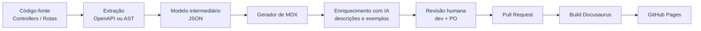

# Automação da documentação de APIs — Portal CIEE

> **Público-alvo:** gestão, Product Owner (PO) e liderança técnica.
> **Objetivo:** explicar como o catálogo de APIs pode sair do modelo manual atual
> para um processo sustentável, padronizado e, no futuro, parcialmente automático.

---

## 1. Resumo executivo

Hoje a documentação é escrita em Markdown/MDX e publicada pelo Docusaurus. O
modelo funciona bem para a POC, mas depende de disciplina manual: se o
desenvolvedor esquece de atualizar o texto, a documentação fica diferente da API
real.

A proposta é evoluir em duas frentes complementares:

1. **Abordagem A (agora):** o desenvolvedor documenta o endpoint usando o
   template oficial durante o desenvolvimento da task.
2. **Abordagem B (evolução):** ferramentas leem o código-fonte ou o contrato
   OpenAPI e geram automaticamente o esqueleto da documentação, com apoio de IA
   para descrições e exemplos. A revisão humana continua obrigatória.

**Recomendação:** começar pela A, criar disciplina e padronização, e evoluir para
a B de forma incremental. A A nunca deixa de existir: ela passa a ser o fallback
para endpoints com regras de negócio complexas ou ainda não anotados.

---

## 2. Problema que queremos resolver

| Problema atual | Impacto |
| --- | --- |
| Documentação escrita manualmente | Consome tempo do dev e do technical writer |
| Endpoints evoluem sem atualizar o texto | Cliente integra com payload ou regra desatualizada |
| Cada dev escreve de um jeito | Navegação e padrão visual inconsistentes |
| Regras de negócio ficam só no código | PO e parceiros não têm visibilidade |
| Descoberta de mudanças é reativa | Suporte e integração recebem dúvidas repetidas |

O objetivo não é “documentar mais”, e sim **reduzir a distância entre o código que
está em produção e o catálogo que o cliente consulta**.

---

## 3. Arquivos desta pasta

```text
templates-docs/
├── README-AUTOMACAO.md      # Este documento (visão de gestão e arquitetura)
└── template-endpoint.mdx    # Template padrão de uma página de endpoint
```

O template fica **fora de `docs/`** de propósito: ele é um modelo de trabalho e
não deve ser publicado no portal sem substituição dos placeholders.

---

## 4. Abordagem A — Desenvolvedor escreve o MDX

### Como funciona

Durante o desenvolvimento da task, o dev:

1. Copia `templates-docs/template-endpoint.mdx` para
   `docs/<cliente>/<nome-do-endpoint>.mdx`.
2. Substitui os placeholders `{{...}}` pelos dados reais.
3. Valida localmente com `npm run start`.
4. Inclui a documentação no mesmo pull request da alteração de código.
5. Roda `npm run build` antes de abrir o PR.

### Exemplo de cópia do template

```powershell
Copy-Item templates-docs\template-endpoint.mdx docs\assobes\meu-novo-endpoint.mdx
```

```bash
cp templates-docs/template-endpoint.mdx docs/assobes/meu-novo-endpoint.mdx
```

### O que o template garante

- Título e descrição padronizados.
- Endpoint com método HTTP e URI.
- Headers de autenticação (`Authorization: Bearer <TOKEN>`).
- Bloco de regras de negócio com admonition nativa do Docusaurus.
- Exemplo de requisição em cURL.
- Payload JSON de entrada e saída.
- Tabela de códigos HTTP.
- Histórico de alterações (audit trail) com data, versão, autor e PR.
- Checklist de revisão.

### Pontos fortes

- Simples de adotar: não exige ferramenta nova.
- O dev tem o contexto da regra de negócio no momento em que escreve o código.
- Funciona para qualquer endpoint, inclusive os muito específicos.
- Custo inicial praticamente zero.

### Pontos de atenção

- Depende de disciplina e revisão no PR.
- Pode gerar inconsistência se o template não for seguido.
- Documentação pode ficar desatualizada se a alteração de código não incluir o MDX.
- Aumenta o esforço do dev em tasks pequenas.

### Quando usar

- Agora, durante a POC e a primeira versão do catálogo.
- Endpoints com regras de negócio complexas.
- APIs legadas que ainda não possuem OpenAPI confiável.

---

## 5. Abordagem B — IA + código-fonte

### Como funciona

A ideia é tratar o código ou o contrato OpenAPI como **fonte da verdade** e gerar
o esqueleto da documentação automaticamente.



### Pipeline proposto

1. **Extração**
   - Java/Spring Boot: anotações `@Operation`, `@Parameter`, DTOs e Bean
     Validation, ou `springdoc-openapi`.
   - Node.js: OpenAPI gerado por `swagger-jsdoc`, decorators ou parsing de rotas
     com `ts-morph`.
2. **Modelo intermediário**
   - JSON com método, path, headers, parâmetros, schemas de entrada/saída e
     códigos de resposta.
3. **Geração do MDX**
   - Um gerador preenche o `template-endpoint.mdx` com os dados extraídos.
4. **Enriquecimento com IA (opcional)**
   - A IA escreve descrições, exemplos realistas e explicações de regras de
     negócio a partir do código, de testes e de documentação existente.
5. **Revisão humana**
   - Dev confirma dados técnicos; PO confirma regras de negócio.
6. **Publicação**
   - O PR gera preview do Docusaurus; o merge publica no GitHub Pages.

### Exemplo de interface futura

> Ainda não implementado. Serve para ilustrar a experiência desejada.

```bash
npm run docs:generate -- \
  --source ./openapi/assobes.json \
  --client assobes \
  --output ./docs/assobes
```

### O que pode ser extraído automaticamente

- Método HTTP e URI.
- Headers obrigatórios.
- Parâmetros de rota, query e body.
- Tipos, obrigatoriedade e validações simples.
- Códigos de resposta previstos.
- Nome de DTOs e campos.
- Autor e data do commit para a tabela de histórico.

### O que ainda exige validação humana

- Regras de negócio que não estão explícitas no código.
- Exemplos com dados fictícios realistas.
- Linguagem adequada para cliente externo.
- Segurança e dados sensíveis.
- Explicação de exceções, limites e acordos comerciais.
- Prioridade e organização do menu.
- Descrição funcional da mudança registrada no histórico de alterações.

### Pontos fortes

- Consistência alta entre endpoints.
- Redução do trabalho repetitivo.
- Documentação pode ser gerada no mesmo pipeline do build.
- Facilita detectar divergência entre código e catálogo.

### Riscos e mitigação

| Risco | Mitigação |
| --- | --- |
| IA inventar regra ou campo que não existe | Revisão obrigatória e geração baseada em schema/OpenAPI |
| Código sem anotações gerar documentação pobre | Checklist de anotações e cobertura mínima |
| Exemplos com dados reais ou segredos | Dados fictícios, lint e secret scanning no CI |
| Documentação gerada ficar genérica | Enriquecimento com contexto de produto e revisão da PO |
| Automação quebrar o build | Preview do Docusaurus em todo PR |
| Divergência continuar | Gerar docs no mesmo PR da alteração de API |

### Quando usar

- Depois que os endpoints tiverem OpenAPI ou anotações mínimas padronizadas.
- Para endpoints CRUD e payloads repetitivos.
- Como apoio ao dev, nunca como substituto da revisão.

---

## 6. Comparativo entre as abordagens

| Critério | A — Dev escreve MDX | B — IA + código-fonte |
| --- | --- | --- |
| Esforço inicial | Baixo | Médio/alto |
| Consistência | Média (depende do time) | Alta |
| Velocidade por endpoint | Média | Alta após o setup |
| Conhecimento de negócio | Alto | Depende de contexto e revisão |
| Risco de desatualização | Médio | Baixo, se integrado ao CI |
| Dependência de ferramenta | Nenhuma | OpenAPI, parser e gerador |
| Melhor uso | POC e regras complexas | Escala e endpoints padronizados |

---

## 7. Recomendação

### Estratégia híbrida, em três passos

1. **Agora:** adotar o template e incluir “documentação” no Definition of Done
   das tasks de API.
2. **Próximo ciclo:** padronizar OpenAPI/anotações e criar um gerador de
   esqueleto MDX.
3. **Depois:** adicionar IA para descrições e exemplos, sempre com revisão humana
   e preview no PR.

### Regra de ouro

> **Automação gera o rascunho. Pessoas aprovam o conteúdo.**

A IA pode acelerar a escrita, mas não deve ser a última palavra sobre regra de
negócio, segurança ou contrato com o cliente.

---

## 8. Governança e qualidade

### Definition of Done de uma API

- [ ] Código e testes implementados.
- [ ] OpenAPI/anotações atualizados.
- [ ] Página MDX criada ou atualizada.
- [ ] Exemplos com dados fictícios.
- [ ] Regras de negócio revisadas pela PO.
- [ ] Histórico de alterações atualizado (data, versão, autor e PR).
- [ ] `npm run build` passando.
- [ ] Preview do Docusaurus validado no PR.

### Quality gates no CI

- Build do Docusaurus.
- Verificação de links quebrados (`onBrokenLinks: 'throw'` já configurado).
- Lint de Markdown/MDX.
- Verificação de placeholders `{{...}}` não substituídos.
- Secret scanning nos exemplos.
- Preview automático do site no pull request.

### Rastreabilidade: histórico no MDX e metadados do Git

Existem duas camadas complementares para registrar a evolução de uma página:

| Camada | O que registra | Onde fica |
| --- | --- | --- |
| **Tabela “Histórico de alterações”** | Data, versão da API, autor, descrição funcional e PR/ticket | Dentro do `.mdx`, visível ao cliente |
| **Metadados nativos do Docusaurus** | Autor e data do último commit do arquivo | Rodapé da página, gerado no build |

A tabela é obrigatória porque explica **o que mudou e por quê**, com a versão do
contrato e o rastreio do PR. Os metadados nativos são automáticos e servem como
segunda evidência, sem depender de disciplina manual.

#### Opção nativa do Docusaurus

O Docusaurus lê o histórico do Git no momento do build e pode exibir o autor e a
data da última atualização no rodapé de cada página. Basta habilitar as opções no
preset de docs em `docusaurus.config.ts`:

```ts
// docusaurus.config.ts
docs: {
  sidebarPath: './sidebars.ts',
  showLastUpdateTime: true,
  showLastUpdateAuthor: true,
},
```

> Neste projeto as opções entram no bloco `docs` do preset `classic`. Se o plugin
> de conteúdo fosse usado isoladamente, elas iriam nas opções do plugin. Na POC as
> duas opções estão desabilitadas; habilitar é uma decisão de governança, não uma
> mudança de conteúdo.

**Pré-requisito no CI:** o Docusaurus consulta o histórico do Git. Em pipelines
com checkout raso (padrão do `actions/checkout`), o histórico não existe e o
rodapé fica vazio. Ajuste o workflow:

```yaml
- name: Checkout
  uses: actions/checkout@v4
  with:
    fetch-depth: 0
```

**Quando o Git não é suficiente:** se a página for copiada, gerada por
automação ou consolidar conteúdo de vários arquivos, o autor do commit pode não
ser o autor real da mudança. Nesse caso, sobrescreva os metadados no front
matter:

```mdx
---
title: "Inserir / Criar Cadastro"
last_update:
  author: "Time de Integrações CIEE"
  date: "2026-10-31"
---
```

**Limitações a considerar:**

- Exibe apenas a **última** atualização, não o histórico completo.
- Depende de o build ter acesso ao repositório Git e ao histórico completo.
- O autor é o autor do commit, que pode ser um bot ou um merge.
- Não substitui a tabela de auditoria exigida em contrato ou auditoria interna.
- Não deve expor e-mail ou dado pessoal do desenvolvedor na página publicada.

### Papéis

| Papel | Responsabilidade |
| --- | --- |
| Desenvolvedor | Documentar o endpoint e manter o exemplo fiel ao código |
| Tech Lead | Revisar padrão, arquitetura e automação |
| PO / área de negócio | Validar regras, linguagem e prioridade |
| Technical Writer | Revisar clareza, consistência e experiência de leitura |
| CI/CD | Garantir build, links e publicação |

---

## 9. Roadmap sugerido

| Fase | Entrega | Objetivo |
| --- | --- | --- |
| 0 — Atual | Template + documentação manual | Padronizar e validar com a PO |
| 1 — Curto prazo | OpenAPI + gerador de esqueleto | Reduzir trabalho repetitivo |
| 2 — Médio prazo | IA para descrições e exemplos | Acelerar a escrita com revisão |
| 3 — Evolução | Cobertura e alerta de divergência | Garantir catálogo sempre atualizado |

As durações devem ser estimadas após a validação do escopo e da qualidade do
OpenAPI existente.

---

## 10. Principais variáveis do template

O template usa placeholders no formato `{{nome_da_variavel}}`. Campos de payload
podem ser renomeados conforme o DTO de cada endpoint.

| Placeholder | Exemplo | Origem esperada |
| --- | --- | --- |
| `{{titulo_endpoint}}` | Inserir / Criar Cadastro | Nome funcional da rota |
| `{{posicao_sidebar}}` | 1 | Ordem no menu |
| `{{descricao_curta_do_endpoint}}` | Cria o cadastro do estudante... | Produto / código |
| `{{metodo_http}}` | POST | Controller / OpenAPI |
| `{{base_url}}` | `https://api.ciee.org.br` | Configuração de ambiente |
| `{{uri_endpoint}}` | `/api/v1/integracao/inserir-cadastro` | Controller / OpenAPI |
| `{{client_id}}` | `ASSOBES_PRD` | Configuração de autenticação |
| `{{regra_negocio_N}}` | Telefone no formato `(XX) XXXXXXXXX` | Código, testes e PO |
| `{{campo_entrada_N}}` | `cpf` | DTO / schema |
| `{{campo_resposta_N}}` | `idCadastro` | DTO / schema |
| `{{id_gerado}}` | `cad_8f3b2c91` | Padrão de identificadores da API |
| `{{mensagem_sucesso}}` | Cadastro processado com sucesso. | Produto / código |
| `{{timestamp_iso_8601}}` | `2026-10-31T14:32:08Z` | Padrão de data/hora da API |
| `{{http_sucesso}}` | 201 | Controller / OpenAPI |
| `{{http_validacao}}` | 400 | Controller / OpenAPI |
| `{{http_nao_autorizado}}` | 401 | Padrão de autenticação |
| `{{http_erro_interno}}` | 500 | Padrão da API |
| `{{descricao_*}}` | Cadastro criado com sucesso. | Texto gerado e revisado |
| `{{data_iso_8601}}` | `2026-10-31 14:00` | Data da alteração registrada |
| `{{versao_api}}` | `1.0.0` | Versão do contrato no histórico |
| `{{nome_desenvolvedor}}` | `Maria Silva` | Autor da alteração |
| `{{descricao_resumida_alteracao}}` | Ajuste na validação do CPF. | Resumo funcional da mudança |
| `{{numero_pr_ou_ticket}}` | `#1024` | PR ou ticket de origem |

---

## 11. Roteiro de demonstração para a reunião (5 minutos)

1. **Contexto (1 min):** mostrar o portal publicado e o problema da documentação
   manual.
2. **Template (1 min):** abrir `templates-docs/template-endpoint.mdx` e destacar
   endpoint, headers, regras, exemplos e status.
3. **Abordagem A (1 min):** mostrar uma página real já publicada, como
   `docs/assobes/inserir-cadastro.mdx`.
4. **Abordagem B (1,5 min):** apresentar o diagrama do pipeline e separar o que
   é automático do que exige revisão humana.
5. **Recomendação (0,5 min):** defender a estratégia híbrida e pedir validação
   da PO para incluir documentação no Definition of Done.

### Mensagem-chave para a PO

> “A documentação deixa de ser um trabalho paralelo e passa a fazer parte da
> entrega da API. No futuro, a engenharia gera o rascunho automaticamente e a
> área de negócio valida o que é publicado.”

---

## 12. Próximos passos e decisões necessárias

- [ ] Aprovar o template como padrão oficial da POC.
- [ ] Incluir documentação no Definition of Done das tasks de API.
- [ ] Mapear quais APIs já possuem OpenAPI confiável.
- [ ] Definir responsável pela revisão de regras de negócio.
- [ ] Priorizar a Fase 1 do roadmap.
- [ ] Definir se o gerador será interno ou integrado ao pipeline existente.
